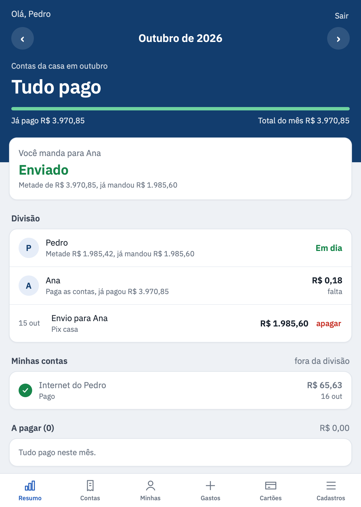
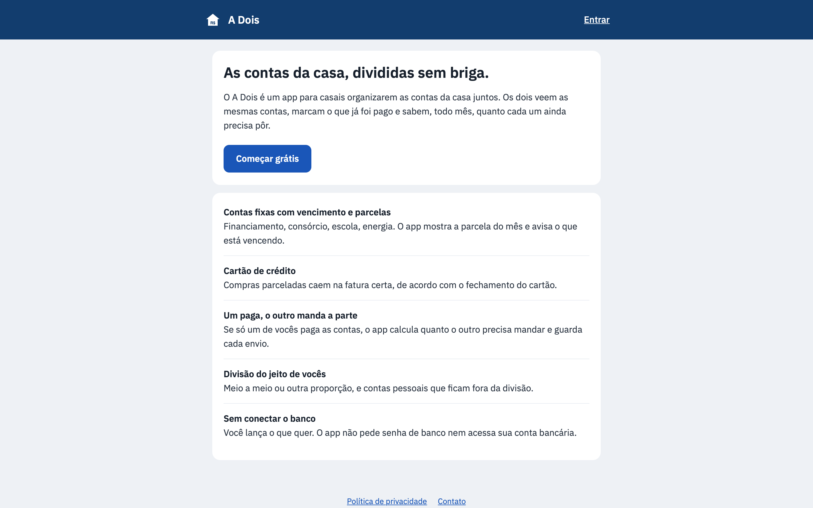

# A Dois: shared bills for couples

**A Dois** ("the two of us") is a web app for couples to manage household bills together. Both partners see the same bills, mark what has been paid and know, every month, how much each one still has to put in.

**Live:** [adoisapp.online](https://adoisapp.online)

| Monthly summary | About |
|---|---|
|  |  |

*Names and amounts in the screenshot are placeholders.*

## Features

- **Fixed bills with due dates and installments:** financing, school, utilities. The app shows the current installment and warns when it is due.
- **Credit card:** installment purchases land on the right statement, based on the card's closing day.
- **One pays, the other sends their share:** the app calculates how much the other partner owes and records each transfer.
- **Flexible split:** 50/50 or any other ratio, plus personal expenses left out of the split.
- **No bank connection:** you enter what you want, the app never asks for bank credentials.
- Sign in with Google or email.

## Stack

- **Frontend:** React, Vite, TypeScript
- **Backend:** Node.js, Express, Google sign-in
- **Database:** SQLite, with multi-household isolation, partner invite links and daily backups
- **Infra:** Docker on a Linux VPS, Nginx, Let's Encrypt SSL, Cloudflare

---

My own product. Source code is private for now; happy to walk through it in a call.

Built by [José Henrique Rodrigues](https://www.linkedin.com/in/josehenriquerodrigues-dev) · SmartHelp LTDA
